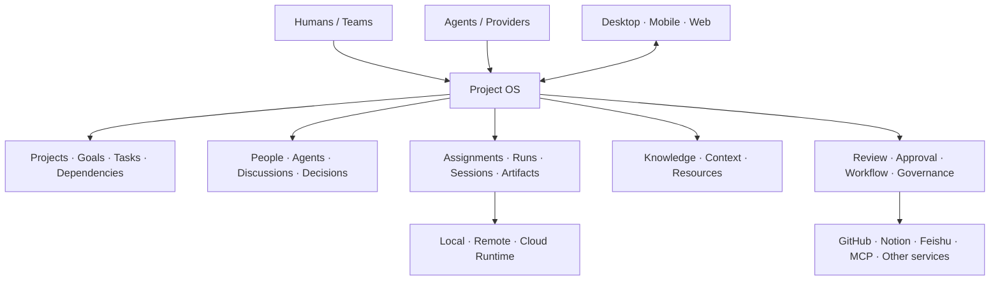

# Agent Project OS

> **Product requirements and development documentation · v0.4 · 2026-11-10**  
> Product codename: **Agent Project OS** (working name; brand not frozen)

An open-source, free-to-self-host Project OS for people and teams working with multiple AI Agents. It unifies long-lived Projects, human–Agent collaboration, multi-Agent execution, local Sessions, knowledge, workflows, integrations, review, governance, and cross-device control.

**The product is organized around Projects, not Agent chats.** People own goals and important decisions. The system maintains project and work state. Humans and Agents can both participate in work. Agent sessions, runs, providers, and machines are replaceable execution resources.

This repository contains the canonical product requirements (PRD), domain model, architecture proposals, and engineering contracts. It is not an implementation repository yet.

## Product positioning and distribution

- **Product center:** durable Projects and accepted outcomes, not Agent chats or a fixed Agent org chart.
- **Design lineage:** AWRP execution reliability + our Linear Project/Current State operating model + DeepSeek DSH event-driven orchestration ideas. This is a new synthesis, not a port.
- **Unification:** one canonical domain, lifecycle, context, permission, attention, and audit model across people, Agents, Sessions, Runs, knowledge, and external systems.
- **Distribution:** open source and free to self-host for personal/team use. The complete core product is not split behind a mandatory subscription. Users bring their own model/provider credentials and pay their chosen inference, hosting, hardware, and third-party service costs.
- **Competitive honesty:** Paperclip, Paseo, and OpenHands Agent Canvas already offer meaningful open-source/self-hosted capabilities. Our differentiation is the quality and breadth of the unified Project-centered lifecycle, not the claim that no free alternatives exist.

Read the full [Product Requirements Document](docs/00-product-charter.md) before changing scope or positioning.

## Current status

- Product direction: **confirmed; design-stage decision: GO — worth developing**.
- Current phase: **Pre-development readiness (G0–G5)**; gates are planned but not yet executed.
- Full capability scope: **preserved**; implementation may be staged, but the product scope is not reduced to an Agent client or execution relay.
- Domain model: **design proposal; requires review before schema freeze**.
- Architecture: **design proposal; technology choices are not frozen**.
- Code: **not started in this repository**.
- Release / production evidence: **none**.

## Read in dependency order

| Order | Document | Main question |
|---:|---|---|
| 00 | [Product Requirements Document (PRD) & Charter](docs/00-product-charter.md) | Why this product, for whom, what is unified, and how is it distributed? |
| 01 | [Functional catalog](docs/01-functional-catalog.md) | What capabilities belong to the complete product? |
| 02 | [Domain model](docs/02-domain-model.md) | What are the durable objects, relations, states, and authorities? |
| 03 | [Project and work management](docs/03-project-and-work-management.md) | How do Projects, Goals, Tasks, dependencies, and Current State work? |
| 04 | [Human–Agent collaboration](docs/04-human-agent-collaboration.md) | How do humans and Agents share responsibility and work? |
| 05 | [Execution and runtime](docs/05-execution-runtime.md) | How are assignments, runs, sessions, runtimes, and recovery represented? |
| 06 | [Delivery, review, and governance](docs/06-review-delivery-governance.md) | How do we prove work is done and authorize side effects? |
| 07 | [Orchestration and autonomy](docs/07-orchestration-and-autonomy.md) | How are work planned, routed, triggered, and continued? |
| 08 | [Knowledge and context](docs/08-knowledge-context-memory.md) | How does durable project knowledge inform execution without polluting it? |
| 09 | [Client experience](docs/09-client-experience.md) | How should Desktop, Mobile, and Web expose the same Project OS? |
| 10 | [Plugins and integrations](docs/10-plugins-integrations.md) | How do providers and external systems connect safely? |
| 11 | [Platform, security, and reliability](docs/11-platform-security-reliability.md) | What cross-cutting infrastructure makes the product dependable? |
| 12 | [Development sequence](docs/12-development-roadmap.md) | In what dependency order should the system be built? |
| 13 | [Competitor and reuse analysis](docs/13-competitor-and-reuse-analysis.md) | What should be learned from existing products and projects? |
| 14 | [Open decisions](docs/14-open-decisions.md) | What is confirmed, proposed, or still unresolved? |
| 15 | [Glossary](docs/15-glossary.md) | What do the terms mean in this product? |
| 16 | [Source traceability](docs/16-source-traceability.md) | Where did each capability and design rule come from? |
| 17 | [Agent development contract](docs/17-agent-development-contract.md) | How should multiple developers and Agent windows work safely? |
| 18 | [Local Agent Session subsystem](docs/18-local-agent-session-subsystem.md) | How does Desktop create/attach local Agent Sessions and continuously receive new messages safely? |
| 19 | [Pre-development readiness](docs/19-pre-development-readiness.md) | What must be reviewed and specified before parallel implementation begins (G0–G5)? |

Templates: [ADR](docs/templates/ADR.md), [Module contract](docs/templates/module-contract.md), [Work package](docs/templates/work-package.md).

## Core product model

## Non-negotiable product invariants

1. **Project is stable; windows, Agents, Providers, Sessions, Runs, and machines are dynamic.**
2. **Task ≠ Assignment ≠ Run ≠ Session.** A Task survives multiple assignments and execution attempts.
3. **Human responsibility and Agent execution are separate.** A human can remain accountable while an Agent performs the work.
4. **Agent completion is not acceptance.** Acceptance requires evidence against explicit criteria and, where required, human approval.
5. **Direct Agent use and coordinated multi-Agent work are both first-class.** A Coordinator is not a mandatory bottleneck.
6. **Project management is broader than coding.** Research, design, operations, documents, external systems, and team work belong in the model.
7. **Autonomous execution is a sub-capability, not the product identity.** Its user-specific execution Skill is a supporting input, not a separate product or control plane.
8. **External systems retain authority over their live facts.** GitHub owns current PR/CI facts; the OS stores references and verified projections.
9. **The complete product scope remains visible.** Delivery is staged by dependency; the product is not redefined as an MVP-only Agent manager.
10. **Complexity must reduce user coordination, not create more of it.** Protocols and state are internal unless they help a real user decision.
11. **Local Agent Sessions are a first-class Desktop capability.** The product must create/open a local Agent Session and continuously receive new messages; Provider Session, RuntimeProcess, and client connection are separate facts.
12. **Direct Session use is supported without a Task.** Project/Task/Run binding is explicit; a Session is not an alternative Project identity.
13. **Open source and free self-hosting are product requirements.** Do not create mandatory paid gates for core Project OS capabilities.
14. **Users control model and infrastructure costs.** BYO model/provider credentials are supported; inference, hosting, hardware, and third-party service charges remain external costs.
15. **Unification is a shared operating model, not a single screen.** Canonical identities, lifecycle, context, permissions, attention, and audit must work across modules and clients.
16. **Competitive claims must be evidence-based.** Do not claim a capability or free/self-hosted position is unique without current primary-source comparison.

## Status labels used in this repository

- `CONFIRMED`: explicitly established by the product owner.
- `PROPOSED`: a design recommendation; not yet frozen.
- `VALIDATION REQUIRED`: depends on current code, external API, user research, licensing, or a real test.
- `REJECTED / NON-GOAL`: explicitly not part of the intended product direction.
- `IMPLEMENTED`: may only be used after code exists and independent verification passes.

Do not promote a proposal to a confirmed decision just because it appears in a document.

## Primary lineage and evidence

- [AWRP repository](https://github.com/Bruce-Yii/agent-relay) — historical protocol and implementation evidence.
- [AWRP protocol](https://github.com/Bruce-Yii/agent-relay/blob/main/protocol/AWRP-0.1.md), [Worker Contract](https://github.com/Bruce-Yii/agent-relay/blob/main/protocol/WORKER-CONTRACT.md), [Coordinator Adapter](https://github.com/Bruce-Yii/agent-relay/blob/main/protocol/CHATGPT-ADAPTER.md).
- [Linear Personal Project OS](https://linear.app/yi383775/project/personal-project-oslinear-notion-governance-a75ee24846a2) — actual Linear + Notion operating model and governance history.
- [Notion product definition](https://app.notion.com/p/40f1e795caee812cb4e6d122fea4d784) and [Notion system architecture](https://app.notion.com/p/40f1e795caee8100a6a9fa9a5de3437d) — current design discussion references.
- [DeepSeek DSH Super-agent prototype](https://github.com/deepseek-ai/dsh-superagent-prototype), [Paperclip](https://github.com/paperclipai/paperclip), [Paseo](https://github.com/getpaseo/paseo), [Superset](https://github.com/superset-sh/superset), [OpenHands Agent Canvas](https://github.com/All-Hands-AI/OpenHands), [Conductor](https://github.com/Conductor-OSS/conductor).
- Local Provider session APIs: [Codex App Server](https://github.com/openai/codex/blob/main/codex-rs/app-server/README.md), [Claude Agent SDK sessions](https://code.claude.com/docs/en/agent-sdk/sessions), [OpenCode Server](https://opencode.ai/docs/server/), [Pi RPC](https://pi.dev/docs/latest/rpc).

Competitor and implementation evidence was reviewed on **2026-11-09**. Local Agent Session design was expanded on the same date from official Provider protocol/SDK documentation. Re-check moving branches, current API support, platform availability, and licenses before implementation.

## Repository contribution rules

- Change the document that owns the subject; do not duplicate the same contract in multiple places.
- Update `14-open-decisions.md` when a material decision changes.
- Record architecture-changing decisions with an ADR.
- Keep API/domain contracts stable before parallel implementation begins.
- Use isolated branches/worktrees for parallel work; never share one mutable checkout between independent Agents.
- Do not add production code, credentials, private customer data, or provider secrets to this documentation repository.

