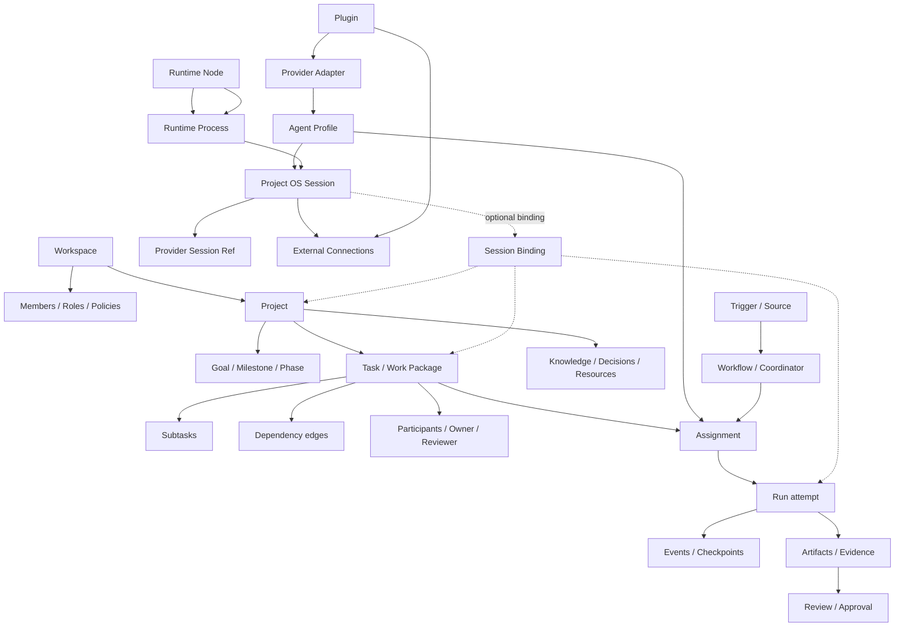

# 02 — Domain Model and Canonical State

**Status:** Proposed domain contract. This document must be reviewed before database schema or API contracts are frozen.

## 1. Modeling principles

1. Model durable work separately from transient execution.
2. Model human accountability separately from Agent execution.
3. Model hierarchy separately from dependency.
4. Model authorization separately from context and routing.
5. Model external truth separately from local projections.
6. Keep a single canonical owner for each fact; other views are projections or references.
7. Do not introduce an entity unless it owns identity, lifecycle, authority, or a durable relationship that cannot be safely represented elsewhere.

## 2. Proposed domain map

## 3. Core entities

### Workspace

Top-level collaboration and permission boundary. Holds members, roles, policies, Agents available to the workspace, plugin grants, and Projects.

### Project

Stable identity for a long-lived line of work. Holds purpose, desired outcomes, scope, owner, status, goals, milestones, project context, and references to external resources. A Project must survive the closure or replacement of every Agent Session and Runtime Node.

### Goal and Milestone

A Goal describes an outcome. A Milestone describes a meaningful stage or checkpoint. Neither is a Task Run. Milestones may group Tasks and expose progress derived from accepted work.

### Task / Work Package

A bounded unit of work with a goal, scope, non-scope, constraints, acceptance criteria, status, priority, accountable owner, and references. A Task may have child Tasks and dependency edges. A Task persists across multiple Assignments and Runs.

**Proposed ownership rule:** a Task has one canonical owning Project for its lifecycle. It may be linked to other Projects as a reference or dependency, but avoid ambiguous multi-owner writes. Validate this against real cross-project scenarios before freezing.

### Task hierarchy vs dependency

- `parent_task_id` expresses decomposition / containment.
- `Dependency` expresses execution or semantic ordering between Tasks.
- A Task may have several dependency edges independent of its parent.
- Dependency graph must be acyclic for scheduling; semantic `related_to` links may be cyclic.

### Participant / Responsibility

A participant can be a human, team, Agent, or service identity. Do not overload one `assignee` field for all responsibility.

Proposed distinct relations:

- `accountable_owner`: person or team ultimately responsible for the Work Package;
- `executor`: Agent or human performing a specific Assignment;
- `reviewer`: person/Agent authorized to assess the deliverable;
- `collaborator` / `watcher`: contributes or observes without owning completion.

This follows a useful Linear distinction: a human can remain the issue assignee while an Agent is delegated to execute it.

### Agent Profile, Provider, and Runtime Node

- `AgentProfile`: logical execution identity, role, capabilities, preferences, and configuration reference.
- `Provider`: adapter family or harness (Codex, Claude Code, OpenCode, Pi, custom provider, etc.).
- `RuntimeNode`: actual machine or environment where work executes (local daemon, remote host, cloud worker, sandbox).
- These are separate objects. An Agent profile can use different Provider versions or Runtime Nodes if compatible.

### Assignment

A durable delegation record connecting a Task/Work Package to an executor, Agent profile, runtime requirement, scope, authority, and acceptance contract. A Task may have multiple parallel Assignments or successive Assignments.

Assignment is not a Run. Reassignment, retry, or scope change must be explicit and auditable.

### Run

One concrete execution attempt for an Assignment. It has a unique `run_id`, attempt identity, start/end, status, idempotency key, executor, runtime, and output references.

**Invariant:** a given Run must not execute the same authorized side effect twice. A genuine revision or retry that constitutes new execution gets a new Run identity.

### Session

A Provider-managed conversation/work session that can emit messages, tool calls, and artifacts. Session is a runtime resource, not the identity of a Task and not identical to the OS process or client connection. The Project OS stores a durable Session identity and Provider reference; provider-native transcript and resume semantics remain owned by the Provider/Adapter and must be protected.

A Session may exist without a Task (direct Agent mode). It may be explicitly associated with a Project/Task/Assignment/Run, but this association does not create an Assignment or grant execution permission. A Session may only be reused across Runs or Tasks when Provider capability and explicit context boundaries make that safe. Rebinding across Project/Task security boundaries requires explicit user action and audit; never silently leak context.

Separate the following facts:

- `ProviderSessionRef`: Provider-native thread/session ID, Provider version, and resumability metadata;
- `RuntimeProcess`: actual local/remote process that may be restarted while the Provider Session survives;
- `SessionConnection`: a transient transport/client subscription; its loss does not end the Session;
- `SessionBinding`: explicit, auditable relation to Project/Task/Assignment/Run, optionally time-bounded;
- `SessionTurn`: one bounded turn/execution segment inside the Session;
- `SessionEventCursor`: Provider cursor and local receive sequence used for replay/reconciliation.

The exact storage/ownership split between Project OS metadata, local Daemon spool, and Provider transcript remains a design decision; do not duplicate full transcript data centrally by default.

### Event and Checkpoint

Events record state-changing facts and important execution/communication facts with actor, timestamp, source, object, causation/correlation IDs, and version. High-volume stdout/token deltas may be streamed or stored separately; they should not flood the canonical business event log.

For local Agent Sessions, distinguish durable message/turn/permission/lifecycle boundaries from transient token deltas and terminal bytes. Keep Provider event IDs/cursors and a local receive sequence when available. Reconnect must replay local spool and reconcile Provider history; an unrecoverable gap must be visible, not silently hidden.

Checkpoints preserve resumable execution state or references. A checkpoint is not automatically a completed Run.

### Session Command Receipt (proposed)

A command sent to a Provider Session should have a unique `command_id`, actor, target Session, command type, payload hash/reference, idempotency key, issue time, delivery state, and Provider receipt/result where available. This prevents blind duplicate sends after a network timeout. Commands to one Session are serialized by default unless its Provider explicitly supports concurrent operations.

### Artifact and Evidence

- `Artifact` is a durable output or immutable external pointer: commit SHA, PR, patch, report, file version, demo, screenshot, or external record.
- `Evidence` records why a claim is believed: test output, CI result, source link, review note, diff, or external status snapshot.
- Both carry provenance and version information.

### Review and Approval

- `Review` assesses a specific deliverable against acceptance criteria and evidence.
- `Approval` grants a specific actor permission to perform a defined action on a defined target within a defined scope and validity period.
- Approval must bind to the exact artifact/version/commit when the target can change.
- Approval is not inferred from a successful Run or from an Agent's statement.

### Decision, Discussion, and Resource

- `Decision`: a durable conclusion with rationale, author, scope, evidence, status, and supersession relation.
- `Discussion Thread`: a communication stream associated with Project, Task, Decision, or external Source. It need not become a Task.
- `Resource`: repository, document, environment, external URL, account, API, calendar, or other reusable Project resource.

### Trigger, Source, Workflow, Subscription

- `Source`: connector or internal producer that observes an event stream.
- `Trigger`: immutable normalized event with source-specific identity and provenance.
- `Workflow`: versioned rules/actions for responding to triggers or schedules.
- `Subscription`: a relation that routes future events/context to a Project, Task, or workflow. A subscription provides context/routing, not permission.

### Skill

A reusable method/prompt/tool procedure that can influence how an Agent prepares or performs work. A Skill is versioned and scoped, but it cannot create authority or override Project policy. A personal execution Skill may inform the autonomy sub-capability.

## 4. Canonical vs derived state

| Data | Canonical owner | Other representations |
|---|---|---|
| Workspace/Project/Task identity | Project OS domain store | UI cache, search index, exports |
| Task lifecycle and dependencies | Task domain | boards, timelines, summaries |
| Assignment/Run/Session relation | Execution domain | Agent dashboard, notifications |
| Project OS Session identity and Session Binding | Project OS execution domain | UI/session list and explicit Project/Task links |
| Provider-native conversation bytes and ProviderSessionRef | Provider/runtime | Protected Provider reference and normalized Session projection |
| RuntimeProcess and SessionConnection live state | Local Daemon / Runtime Node | Host/session health projection |
| Local event spool and replay cursor | Local Daemon, with sync policy | Replayed normalized Session events; explicit Event Gap if unrecoverable |
| Git commit/PR/CI state | GitHub or Git forge | verified Project OS projection |
| Notion page content and permissions | Notion | connector index/reference |
| Agent execution logs | Runtime/observability store | compact Project activity summary |
| Review verdict and Approval | Governance domain | task status projection |
| Project Current State | Project OS canonical structured fields + derived snapshot | dashboard summary/cache |

## 5. Session lifecycle and capability semantics (candidate)

Session state is separate from process and connection state.

- Session: `Created → Connecting → Idle ↔ Running → Completed/Interrupted/Failed/Archived` with `WaitingInput` and `WaitingApproval` as meaningful attention states; `Unavailable` means the Provider/host cannot currently be reached, not that the Provider Session is deleted.
- RuntimeProcess: `Starting → Running → Exited/Failed/Unknown`.
- SessionConnection: `Connected ↔ Reconnecting → Disconnected`.
- Provider capability: each operation is `Native`, `Emulated`, `Unsupported`, or `Unknown`.

A UI close or transport disconnect must not automatically close a Provider Session. A Provider process exit does not prove its persisted Session cannot resume. A Session can be reattached only if the Provider/Adapter confirms the relevant identity and capability.

## 6. State machines (candidate semantics)

### Project

`Planning → Active ↔ Paused → Dormant → Archived`

A Project can return from Dormant/Paused to Active. Completed may be used when the Project's declared outcome is accepted and no further work is expected; do not use Completed as a substitute for Dormant.

### Task

Candidate semantic states:

- `Backlog`: discovered but not ready;
- `Ready`: bounded and eligible for work;
- `In Progress`: actively owned/being executed;
- `Waiting`: an external dependency or scheduled event is awaited;
- `Blocked`: an internal blocker prevents progress;
- `In Review`: deliverable is awaiting acceptance;
- `Accepted`: acceptance criteria passed;
- `Canceled`: intentionally stopped;
- `Duplicate`: represented by another canonical Task.

Final names and transitions require design validation. Preserve semantic distinctions even if UI labels change.

### Assignment

`Proposed → Authorized → Dispatched → AcceptedByExecutor → Active → Handoff/Ended/Failed/Revoked`

### Run

`Queued → Dispatched → Running → Handoff/Failed/Interrupted/Canceled → Reviewed`

`Handoff` means the executor delivered a result; it does not mean the Task is Accepted.

### Review

`Pending → Accepted | ChangesRequired | Rejected | NeedsEvidence`

### Approval

`Requested → Granted | Denied | Expired | Revoked | Consumed`

## 7. Core invariants

1. Stable Project identity never depends on a chat/session/window ID.
2. Task, Assignment, Run, and Session have different IDs and lifecycles.
3. A Run cannot be replayed as if it were a new execution.
4. A new revision uses a new Run; the Task remains the same unless the work boundary truly changes.
5. A Session cannot silently change its Project/Task context boundary.
6. Assignment scope cannot exceed the actor's authorization.
7. Context subscriptions do not grant execution permission.
8. A Run success does not close a Task; Review/Acceptance does.
9. External truth is refreshed from the owning system before consequential decisions.
10. Project Current State must include freshness/source information; a stale snapshot cannot masquerade as live truth.
11. Every externally visible side effect is idempotent or reconciled before retry.
12. All important state changes have actor and provenance.
13. A Session can exist without a Task; direct Agent use is a first-class path.
14. Closing a client connection does not imply Session termination; Session, ProviderSessionRef, RuntimeProcess, and SessionConnection remain distinct.
15. A reconnect does not prove the event history is complete; missed events must be reconciled or represented as an explicit Event Gap.
16. A Session command has an identity/receipt and is not blindly resent after an uncertain timeout.

## 8. Questions before schema freeze

- Can a Work Package be shared by multiple Projects, or must one Project own it with cross-project links?
- Can a Session be reused across multiple Tasks, and under what context isolation rules?
- Is Assignment one executor at a time, or can a single Assignment represent a coordinated group? Recommendation: one bounded executor responsibility per Assignment; parallelism is multiple Assignments.
- Which Discussion/Thread types deserve durable first-class records versus external references?
- How much of Project Current State is structured canonical data versus derived summary?
- What is the minimum cross-workspace permission model for shared Agents and plugins?
