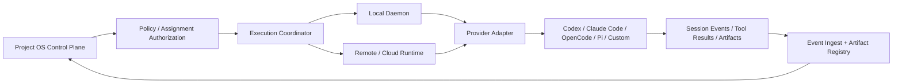

# 05 — Execution Plane, Agent Runtime, and Session Lifecycle

## 1. Boundary

The Project OS Control Plane owns Project/Task/Assignment/Run state and authorization. The Execution Plane owns actual Agent processes, terminals, workspaces, tool calls, and provider-specific Session behavior. Desktop must provide a first-class local Session workbench: create/open a local Agent Session and continuously receive new messages. See [Local Agent Session Subsystem](18-local-agent-session-subsystem.md) for the detailed product/runtime contract.

The product must not assume every Provider supports the same lifecycle operations. Capabilities are negotiated and surfaced honestly.

## 2. Runtime topology

A Paseo-style independent Daemon is a strong reference: it can manage local Agent processes while Desktop, Mobile, Web, and CLI clients connect to it. Our product extends the same separation to the broader Project OS and must support non-coding work as well.

## 3. Core runtime objects

- **Agent Profile:** logical identity and preferred configuration.
- **Provider Adapter:** integration with a particular Agent CLI, SDK, or API.
- **Runtime Node:** local machine, remote host, cloud worker, or sandbox.
- **Workspace:** execution directory/context, potentially a local checkout or Git worktree.
- **Session:** provider-managed conversation/process.
- **Assignment:** authorized work delegation.
- **Run:** one execution attempt.
- **Execution Event:** normalized lifecycle event with raw provider event reference.

## 4. Provider capability negotiation

Each adapter should declare capabilities, for example:

- `session.discover`, `session.create`, `session.attach`, `session.resume`, `session.fork`, `session.list`, `session.history.read`;
- `message.send`, `turn.steer`, `message.queue`, `events.subscribe`, `events.replay`, `tool_calls.stream`;
- `turn.interrupt`, `session.cancel`, `session.archive`, `permission.respond`;
- `workspace.local`, `workspace.worktree`, `workspace.remote`;
- `artifact.diff`, `artifact.commit`, `artifact.files`;
- `usage.tokens`, `usage.cost`;
- `permission.request`, `permission.grant`.

Capability support can be `native`, `emulated`, `unsupported`, or `unknown`. The UI must distinguish:

- resume the same provider Session;
- restart a new Session with a reconstructed Context Pack;
- reconnect to an existing process;
- continue only from a durable Task/Run checkpoint.

Never label a restart-with-context as true session resume.

## 5. Run lifecycle

Candidate sequence:

1. Scheduler creates Assignment after policy check.
2. Execution Coordinator creates a unique Run and idempotency key.
3. Runtime verifies the target node and workspace.
4. Provider adapter creates or resumes a Session.
5. Executor ACKs the exact Run before material work.
6. Run emits meaningful events/checkpoints and creates artifacts.
7. Executor hands off a structured report.
8. Review checks evidence and external truth.
9. Task is accepted, returned for revision, or blocked pending a decision.

A Run may be interrupted, failed, or canceled. A new revision gets a new Run identity; do not replay the same Run as a new execution.

## 6. AWRP principles to preserve

AWRP v0.1.5 provides unusually concrete reliability lessons:

- Project identity is canonical; local Session/focus state is not the Project owner.
- Task spans multiple Runs; a Run is one concrete attempt.
- Event history is append-only and validated; generated projections do not override canonical state.
- The same `run_id` must not execute twice.
- ACK precedes material work; HANDOFF must reference durable, reviewable artifacts.
- A new revision uses a new Run.
- Claims, monotonic generations, CAS, fencing, route-conflict checks, and isolated execution views prevent competing writers and unsafe parallel checkouts.
- Post-run evidence can be recorded without reopening execution authority.
- A connector transports validated canonical bytes; it must not invent domain semantics.

These are product invariants to translate into the new database/event architecture. They do **not** require keeping GitHub JSON files as the product's primary database or copying AWRP's entire protocol unchanged.

## 7. Parallel execution and workspace isolation

Default behavior for concurrent code-changing Runs should be isolated workspaces (e.g. separate Git worktrees/branches or sandbox directories).

- Never let independent Agents write into the same mutable checkout by default.
- Detect dirty state, wrong branch, stale head, or uncommitted foreign changes; fail closed rather than stash/reset/discard another worker's bytes.
- A Run's workspace identity and base revision must be recorded.
- Merge/rebase integration is a separate operation with conflict evidence and review.
- Non-coding tasks use suitable isolation (documents, browser sessions, data scopes) rather than assuming Git worktrees.

## 8. Local Daemon and remote execution

Local Daemon responsibilities:

- pair with the Project OS account/workspace;
- discover installed local Agent Providers, versions, capabilities, and running Provider Sessions;
- create/manage Provider processes and reattach to existing Sessions where supported;
- continuously consume Provider event streams/stdout with bounded buffering, backpressure, and local event spooling;
- expose authenticated Session commands and independent event subscriptions to Desktop/Web/Mobile clients;
- reconcile missed Provider events from history APIs after reconnect, or mark an explicit event gap;
- keep Session, RuntimeProcess, and SessionConnection states distinct;
- discover installed Providers and their capabilities;
- manage Agent processes and local workspaces;
- expose authenticated commands and event streams;
- report host health and connectivity;
- protect local credentials and files;
- recover or mark interrupted processes accurately after restart.

Remote/Cloud Runtime responsibilities:

- execute when the user's local machine is offline;
- isolate workloads and secrets;
- maintain durable run state;
- expose authenticated remote control;
- report costs, logs, and artifacts.

A phone cannot start a process on a powered-off PC. If execution must continue, it needs an online local host or a remote runtime.

## 9. Structured handoff contract

Every completed or interrupted execution should return:

- Task, Assignment, Run, Session IDs;
- summary and actual work performed;
- verification commands/tests and observed results;
- exact repository/branch/commit SHA or artifact version;
- files changed and diff reference;
- external side effects performed;
- remaining risks, blockers, and decisions needed;
- whether the Provider Session can truly resume;
- timestamps and source provenance.

A local success without durable handoff is not canonical completion.

## 10. Local Agent Session workbench

The Desktop client must support direct local Session creation and continuous message reception as a product requirement. The user can also attach to an existing Provider Session where supported. This capability must work without requiring a Task to exist; Project/Task/Run association is explicit and optional for direct mode.

The detailed contract covers:

- Local Daemon lifecycle and client connection model;
- Provider adapters for Codex App Server, Claude Agent SDK, OpenCode Server, Pi RPC, and future providers;
- structured streaming, terminal fallback, history reconciliation, event cursors, and explicit gaps;
- send/steer/queue/interrupt semantics and command idempotency;
- Session transcript, tool activity, permission prompts, files/diffs, artifacts, usage, and notifications;
- multi-client observation/control, local privacy, secure pairing, and host offline truth.

**Important:** a Desktop UI disconnect must not end a Session; a Provider process exit does not necessarily delete a Provider Session; a reconnect does not prove no messages were missed. These states must be represented separately. See [18 — Local Agent Session Subsystem](18-local-agent-session-subsystem.md).

## 11. Acceptance criteria

- A Run is never executed twice under the same identity.
- A Session can be traced to its Provider, Runtime, Project, Task, and Run context.
- A provider capability mismatch is visible, not silently emulated.
- Local Agent sessions survive client-window closure when the runtime supports it.
- A local host outage is represented as offline, not as a running Agent.
- Parallel code work is isolated by default.
- Handoff artifacts can be independently read and reviewed.
- Provider-specific credentials never enter general Project Memory or logs.
