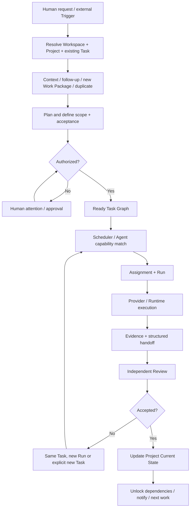

# 06 — Orchestration, Workflow, and Autonomous Execution

## 1. Orchestration is a Project capability

Orchestration exists to organize work across Projects, Tasks, people, Agents, and tools. It is not a separate product identity and must not become a mandatory conversational bottleneck.

The Coordinator plans and routes. The Scheduler selects eligible work and resources. The Execution Plane runs work. The Policy Engine determines authority. Review determines acceptance.

Do not introduce a separate top-level "Project Supervisor" entity merely to rename the Project state and orchestration responsibilities. Project status, scheduling, and coordination should remain explicit capabilities within the Project OS.

## 2. Control flow

## 3. Coordinator responsibilities

- resolve existing Project and Task before creating new objects;
- assemble current state, constraints, decisions, and evidence;
- split work only where separate ownership/execution/acceptance boundaries justify it;
- define Goal, Scope, Non-scope, hard constraints, acceptance criteria, risks, and external effects;
- choose direct execution or delegated orchestration;
- identify dependencies and parallelizable work;
- monitor structured reports and exceptions;
- review evidence independently and propose corrections;
- update Project Current State and relevant downstream work.

The Coordinator should not hand-author canonical state transitions or bypass policy.

## 4. Scheduler responsibilities

- find Tasks that are ready and authorized;
- match required capabilities to Agent Profiles and Runtime Nodes;
- account for availability, concurrency, budget, project priority, and workspace isolation;
- avoid assigning two writers to the same mutable resource without a conflict protocol;
- respect dependency gates;
- record why an assignment was chosen;
- expose unavailable capacity rather than silently dropping work.

## 5. DeepSeek DSH ideas and translation

DSH's public prototype is valuable because it separates event intake, judgment, authorization, work ownership, assignment, and source communication.

| DSH concept | What it solves | Project OS translation | Caution |
|---|---|---|---|
| Source | External stream and read cursor | Connector / Trigger Source | Source-specific identity must remain traceable |
| Trigger | Immutable incoming event | Normalized Trigger | Deduplicate by source event identity |
| Thread | Ordered context stream | Discussion/Source Thread | A thread is not a Project or Task |
| Eval | Decide whether event creates/continues work | Intake/Policy Evaluation | Avoid treating every message as a new Task |
| Mandate | Scope and strength of granted authority | Authorization/Mandate record | Context does not grant permission |
| Ticket | Authorized work unit | Task/Work Package plus authorization | DSH Ticket is not automatically our Task schema |
| Assignment | Binding to an executor | Assignment | Keep separate from Run and Session |
| Subscription | Event/context fan-out | Subscription relation | Subscription does not authorize side effects |
| Channel | Source write-back destination | Connector channel / response route | Keep transport separate from domain logic |
| Outbox | Durable external effect delivery | Transactional Outbox | Commit domain state before external effect execution |
| Engine | Single writer for domain transitions | Domain command handler / application service | Preserve transactional authority and narrow ports |

Useful DSH engineering ideas:

- one domain Engine owns writes to core aggregates;
- commands update aggregates transactionally;
- external work is queued in an Outbox and performed after commit;
- idempotency prevents duplicate trigger intake and duplicate effects;
- policy changes are versioned and re-evaluated at defined boundaries;
- interrupted assignments resume through explicit recovery;
- source events are batched and evaluated against existing work to avoid duplicates.

Do not copy DSH's product assumptions wholesale: its prototype is tied to a specific Harness/runtime, source types, and operating environment; it is not a general Project management platform or a cross-provider client suite.

## 6. Autonomous execution — subordinate capability

Autonomous execution is one optional way to progress Project work under a user-defined mandate. It is not the product's primary identity.

The autonomy feature may:

- inspect the authorized Project/Task state;
- identify eligible next work;
- use the Scheduler to choose a suitable Agent/Runtime;
- continue after a successful handoff or event;
- retry only within explicit bounded rules;
- stop at missing decisions, permission boundaries, or unsafe uncertainty;
- present meaningful results and attention items to the human.

### Dependency on Personal Execution Skill

A **Personal Execution Skill** can be distilled from the user's established Agent workflow: how they prepare a task, structure context, define scope, delegate, verify, handle blockers, and hand off results.

The autonomous-execution sub-capability can load that Skill as its execution-method profile. The Skill is a supporting dependency/method input; it is not a separate product, separate control plane, permission grant, or replacement for the Project OS execution model.

Skill extraction must preserve provenance and require user validation before treating a derived method as trusted. A Skill cannot expand the Task scope or authorize an external side effect.

## 7. Failure and recovery policy

- transient delivery failure: retry idempotently with bounded backoff;
- Agent failure: preserve the Run failure evidence and decide whether a new Run is warranted;
- interrupted process: mark interrupted and recover from a checkpoint or explicit new Run;
- ambiguous work: stop and request a decision;
- external side effect with unknown outcome: reconcile against the external system before retry;
- Policy change: re-check future actions; do not silently revoke or expand an already authorized action;
- dependency blocked: continue independent Tasks where safe;
- no eligible work: report waiting/idle accurately, not as a failure or fabricated progress.

## 8. Acceptance criteria

- Direct Agent use does not require Coordinator involvement.
- A multi-Agent plan creates bounded Assignments with clear dependencies.
- Triggers are deduplicated and resolved against existing Tasks.
- External effects are durable and idempotent.
- The system can recover interrupted Assignments without repeating already completed side effects.
- Autonomy remains within a user-authorized mandate and uses the Personal Execution Skill only as a method input.
- Human decisions are requested only at genuine authority or uncertainty boundaries.

