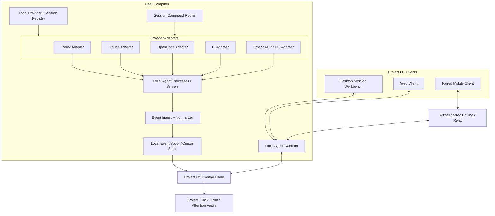

# 18 — Local Agent Session Subsystem

**Status:** Product requirement partly confirmed; detailed protocol and storage design proposed.  
**Scope:** Desktop-hosted local Agents, live Session interaction, continuous event/message reception, and safe attachment to the wider Project OS.  
**This is a core Desktop capability, not the product's identity.** It does not turn the Project OS into a coding-agent launcher.

## 1. Product requirement

The Desktop client must be able to:

1. discover and connect to Agent runtimes available on the user's computer;
2. create a Session with a selected local Agent;
3. attach to an existing/running Session when the Provider supports it;
4. continuously receive newly emitted Agent messages and meaningful execution events while the Session is active;
5. send follow-up messages and control the Session where the Provider supports those operations;
6. keep the Session usable when the UI window is closed or another client reconnects, provided the local Daemon and Provider process remain alive;
7. optionally associate the Session with a Project, Task, Assignment, or Run without forcing every direct conversation to begin as a Task.

**Product-owner-confirmed minimum:** the local Desktop product can open/create a Session with a local Agent and continuously read newly arriving messages. Other capabilities in this document are design requirements/proposals to complete that experience; provider-specific support must be validated.

## 2. Why this is first-class

The Project OS must not only store an Agent's name on a Task. It must provide a real interaction surface for the local Agent ecosystem. A user should be able to open Codex, Claude Code, OpenCode, Pi, or another compatible Agent inside the product, observe its new messages as they arrive, reply, inspect its work, and connect the conversation to project work when useful.

This is one capability inside the wider Project OS. The product remains centered on long-lived Projects, human/Agent collaboration, work management, knowledge, delivery, and cross-device visibility.

## 3. User journeys

### 3.1 Direct local Session

1. User opens the Agent Session workbench.
2. Desktop discovers configured local Providers and their capabilities.
3. User selects an Agent/model and a working directory or workspace.
4. The product creates a Provider Session through its adapter.
5. The user chats directly; messages and events stream continuously into the workbench.
6. The user can later associate the Session with an existing Project/Task or leave it as a standalone Session.

### 3.2 Project/Task-bound Session

1. User opens a Project or Task and chooses **Open Agent Session**.
2. The product prepares a visible Context Pack: project goal, task scope, constraints, acceptance criteria, selected resources, workspace, and allowed Skills.
3. User reviews/adjusts the context and launches a local Agent.
4. Session, Assignment, and Run are linked with explicit IDs and provenance.
5. Agent events and resulting Artifacts are visible from both the Session and the Project/Task.
6. A Session handoff does not automatically accept the Task; the normal Review flow still applies.

### 3.3 Attach to an existing Session

1. User selects an existing Provider Session or running local process.
2. Adapter verifies that it can attach/resume the exact Provider Session.
3. Product loads available history and current status, then subscribes to new events.
4. If only a new Session with reconstructed context is possible, the UI must label it as a restart/continuation, not a native resume.

### 3.4 Cross-device observation and control

1. Local Daemon remains online on the user's computer.
2. Desktop, Web, or paired Mobile client connects through an authenticated channel.
3. Clients can observe the same Session; control permissions are checked separately.
4. If the computer sleeps, shuts down, or loses connectivity, clients show the host as unavailable. They must not imply that a local process continues running.

## 4. Object boundaries

Do not collapse these objects:

| Object | Meaning | Lifetime |
|---|---|---|
| `Session` | Project OS identity for one Provider conversation/work session | Durable; may outlive process/client connections |
| `ProviderSessionRef` | Provider-native thread/session ID and provider metadata | Provider-owned |
| `RuntimeProcess` | Actual local process or server-side execution process | Ephemeral; may restart independently |
| `SessionConnection` | A live transport/subscriber connection from a client or Daemon | Ephemeral |
| `SessionTurn` | One user/Agent turn or provider execution turn | Bounded within Session |
| `SessionEvent` | Normalized event with source provenance and ordering | Append/replay policy; some high-volume deltas are transient |
| `SessionBinding` | Explicit association to Project, Task, Assignment, or Run | Time-bounded / auditable |
| `ContextSnapshot` | Exact context and resource versions supplied at Session/Run start | Immutable reference for provenance |

A Provider Session may persist after its CLI process exits. A process may be reconnected to an existing Provider Session. A client connection can disappear without ending the Session. These are different facts and must be represented separately.

### 4.1 Session and Task/Run relationships

- A direct Session may have no Task or Run.
- A Task may have multiple Sessions over time, e.g. separate research and implementation conversations.- A Run may use one or more Sessions when the Provider/Run contract permits it.
- A Session must not silently move between Projects or Tasks with different access/context boundaries.
- Reusing one Session across multiple Tasks is **not the default**. It requires an explicit binding change, visible context boundary, and audit record.
- A Session association is not a Task assignment and does not grant permission to execute the Task.

## 5. Runtime architecture

### 5.1 Local Daemon responsibilities

- start on user login or on demand; expose health and version;
- discover configured Provider executables/servers and detect versions;
- own the lifecycle of Agent processes it starts;
- connect to externally started Provider servers when explicitly configured;
- maintain Session-to-Provider references and local process/connection state;
- route commands to the correct Provider Adapter;
- continuously read Provider event streams and stdout/stderr channels without blocking the process;
- normalize events, maintain cursors, and spool events while clients or Control Plane are disconnected;
- support multiple connected clients and independent subscriptions;
- enforce local file, process, credential, and network permissions;
- recover after Desktop UI restart and report process/host truth after Daemon restart.

The Daemon is a local execution service, not the Project domain authority. It must not silently invent Task or Project state.

### 5.2 Provider Adapter responsibilities

Each Provider Adapter translates the common Session contract into the Provider's native protocol. It must declare capability support as `native`, `emulated`, `unsupported`, or `unknown`.

Candidate adapter operations:

- `discover()` / `health_check()` / `get_version()`;
- `capabilities()`;
- `list_sessions()` / `get_session()` / `read_history()`;
- `create_session()` / `attach_session()` / `resume_session()` / `fork_session()`;
- `send_message()` / `steer_active_turn()` / `queue_follow_up()`;
- `subscribe_events(cursor?)` / `reconcile_history(cursor?)`;
- `interrupt_turn()` / `cancel_session()` / `close_connection()`;
- `respond_to_permission_request()`;
- `get_artifacts()` / `get_diff()` / `get_usage()` where supported.

Do not pretend every Provider supports every operation. The UI must show native, emulated, or unavailable capabilities.

## 6. Provider integration modes

Prefer the most structured and stable official interface available. Do not begin with brittle terminal UI scraping when an official API/SDK/protocol exists.

| Provider | Current documented integration surface | Useful capability evidence | Caveat / validation |
|---|---|---|---|
| Codex | `codex app-server`, JSON-RPC over stdio; local WebSocket transport is documented as experimental/unsupported | thread start/resume/fork, turn start/steer/interrupt, notifications and item/message deltas | Pin supported protocol version; test process supervision, thread persistence, and sandbox behavior |
| Claude Code | Agent SDK / CLI structured streaming | session ID, resume by ID, continue, fork, partial message streaming, tool permission callbacks | SDK and CLI behavior/version must be pinned; validate long-lived process and local credential handling |
| OpenCode | Local Server HTTP API + SSE event stream | session create/list/read, send/prompt async, message history, abort, permissions, diffs | Current event stream is documented as volatile; slow consumers/disconnections can miss events, so history reconciliation is required |
| Pi | Long-lived RPC subprocess with JSONL command/response/event protocol | bidirectional commands, session state, message/tool/turn events | stdout must be consumed continuously; strict JSONL framing and backpressure handling are required |
| Other / ACP / custom | Adapter-specific SDK, protocol, CLI, or terminal fallback | determined by capability negotiation | Terminal-only fallback is opaque; do not claim structured tool/message events if not available |

A first implementation should prove the Adapter contract against one real Provider end-to-end, then add other Providers without changing the Project domain model. Full-product Provider coverage remains open; this is implementation sequencing, not a scope cut.

## 7. Continuous message and event reception

### 7.1 Event categories

| Category | Examples | Handling |
|---|---|---|
| Conversation | user message, assistant message, message delta, final message | Render as transcript; persist final message and required provenance |
| Turn lifecycle | turn started, turn completed, retry, interruption | Update Session/Run projection |
| Tool activity | tool call started, arguments/progress, tool result | Show timeline; preserve structured details subject to privacy/retention |
| Permission | approval requested, approved, denied, expired | Route to Attention Center; bind approval to exact action/target |
| Workspace | file changed, diff ready, terminal output, preview ready | Use dedicated views/streams; avoid flooding Project activity |
| Session lifecycle | created, attached, resumed, disconnected, archived, failed | Update Session state and connection health |
| Usage/diagnostics | token usage, cost, rate limit, context compaction, process health | Aggregate into observability and diagnostics |

### 7.2 Streaming vs durable storage

Not every token delta or terminal byte should become a canonical business event.

- Stream high-volume deltas to currently attached clients with bounded buffering and backpressure.
- Persist durable message boundaries, turn completion, tool/permission boundaries, Session lifecycle, important artifacts, and command receipts.
- Keep provider-native event IDs/cursors and local monotonically increasing receive sequence numbers where possible.
- Keep raw provider payload references for diagnostics/compatibility where policy permits; do not expose secrets in logs.
- Keep terminal byte streams and large outputs in a separate bounded stream/artifact channel.
- Preserve a compact Project Activity projection; do not flood the Project timeline with every token or stdout line.

### 7.3 Reconnect and gap recovery

On client reconnect:

1. client sends its last acknowledged local event cursor;
2. Daemon replays locally spooled events after that cursor;
3. Adapter reconnects to the Provider stream;
4. if provider event history is available, read/reconcile history from the last durable message/turn marker;
5. deduplicate by provider event ID or stable content/turn identity;
6. if a gap cannot be recovered, mark the Session timeline with an explicit `event_gap` and show the last verified time;
7. never silently present an incomplete stream as complete.

Some Provider event streams are best-effort/volatile. A successful WebSocket/SSE reconnect does not prove no messages were missed. Reconciliation is a required adapter behavior when history APIs exist.

## 8. Session interaction model

The workbench should support:

- create Session, select Agent/model/profile, set working directory/workspace;
- attach to or resume a known Provider Session;
- send a new message;
- steer an active turn only when native capability exists;
- queue a follow-up message separately from steering;
- interrupt active turn, cancel or close Session where supported;
- fork/branch a Session where supported;
- inspect transcript, tool calls, approvals, terminal, files, diff, artifacts, usage;
- rename, pin, archive, search, filter, and switch between multiple Sessions;
- mark unread/read and notify on new message, approval, failure, or completion;
- detach a Project/Task binding without deleting the Provider Session;
- hand off work to another Provider by generating a structured Context Handoff (goal, constraints, decisions, transcript summary, artifacts/workspace refs, open questions); this creates a new Provider Session and is not described as native Session migration;
- export or delete local Session metadata/transcript according to retention policy.

Do not equate `interrupt turn`, `cancel Run`, `close transport`, `terminate process`, `archive Session`, and `delete Session`. These are different actions with different side effects.

## 9. Command ordering and multi-client control

- Every client command receives a unique `command_id` and an idempotency key where a retry could duplicate work.
- Commands to one Provider Session are serialized by default unless the Provider explicitly supports concurrent operations.
- While a turn is active, UI must distinguish **steer now**, **queue next message**, and **interrupt then send**.
- Multiple clients may subscribe to one Session independently.
- Proposed default: one active controller lease per Session; other clients are observers until they explicitly take control. Lease transfer must be visible and auditable.
- A stale client cannot overwrite a newer controller's command state.
- If command outcome is unknown after disconnect, reconcile Provider Session state before retrying.

## 10. Context and project association

Before launch, show the user what context will be provided:

- workspace / working directory;
- Project purpose, scope, and current state;
- Task goal, non-scope, constraints, and acceptance criteria;
- selected project documents, repository references, and artifacts;
- approved Skills and Agent profile instructions;
- permission mode and allowed tools.

Context injection must be explicit and inspectable. Do not automatically inject every Project document or all prior Session messages. Record a `ContextSnapshot` reference/version for a Task-bound Run. Context is not permission: a document or Skill cannot grant a Provider new access.

## 11. Security and local privacy

- bind the local control interface to loopback/OS IPC by default; do not expose an unauthenticated LAN listener;
- pair remote clients with explicit user approval and authenticated encrypted transport;
- store provider credentials in OS credential storage or an approved secret vault; never sync them as Project data;
- constrain working directories and file access; show the effective filesystem scope;
- distinguish read-only, local write, shell execution, network access, and external/public side effects;
- route Provider permission requests through the shared Policy/Approval model;
- redact secrets from logs, events, transcripts, and search indexes where feasible;
- provide per-Session sync/retention controls: local-only, metadata-only, selected transcript sync, or workspace-shared (exact modes require product/security validation);
- support disconnect, revoke pairing, stop Daemon, terminate process, and emergency stop;
- remote/mobile control must never bypass the same authorization rules as Desktop.

## 12. Reliability and lifecycle edge cases

| Scenario | Required behavior |
|---|---|
| Desktop UI closes | Daemon/Provider may continue; Session remains attachable if host stays online |
| Daemon restarts | Re-discover processes/Provider sessions; reconcile; mark unknown state honestly if not recoverable |
| Provider process exits | Mark process ended; Provider Session may still be resumable; do not conflate the two |
| Computer sleeps/offline | Report host unavailable; remote clients cannot control a local process until host returns |
| Stream disconnects | Reconnect, replay local spool, reconcile Provider history, or mark an explicit gap |
| Slow UI consumer | Apply bounded buffering/backpressure; do not block Provider stdout indefinitely |
| Duplicate event delivery | Deduplicate by provider ID/cursor or stable idempotency key |
| User sends twice due to timeout | Reconcile command receipt/Provider state before retrying |
| Session bound to wrong Project | Require explicit rebind and context/permission validation; log the change |
| Provider lacks resume | Offer new Session with reconstructed Context Pack and label it accurately |
| Provider lacks structured events | Offer terminal/opaque mode with visible limitations; do not fabricate semantic events |
| Multiple clients send concurrently | Serialize or enforce controller lease; expose conflicts instead of silently interleaving |

## 13. Desktop, Web, and Mobile experience

**Desktop:** full Session workbench, local Provider setup, Session list, transcript, streaming, terminal, file/diff, approval, context preview, process/runtime diagnostics.

**Web:** Project and Session overview; remote Session interaction only when connected through an authorized Daemon/Runtime. It must not imply local process availability when the host is offline.

**Mobile:** observe new messages, reply, send follow-up, approve/deny, interrupt or take control where supported; show host availability and connection state. It is not required to reproduce a full terminal/IDE.

## 14. Acceptance criteria

A real end-to-end acceptance test must prove:

1. detect a supported local Provider and report version/capabilities;
2. create a Session from Desktop and receive the Provider Session ID;
3. send a message and display new Agent message deltas continuously;
4. display tool/permission/status events with correct provenance;
5. send a follow-up and distinguish queued vs steering behavior;
6. close/reopen Desktop while Daemon/Provider stays online, then reattach without creating a duplicate Session;
7. disconnect/reconnect the event stream and reconcile missed messages or show an explicit gap;
8. associate a Session with a Project/Task and preserve the binding and ContextSnapshot;
9. keep a direct standalone Session usable without a Task;
10. ensure a Provider capability not supported is shown as unavailable, not silently simulated;
11. verify permissions and credential isolation;
12. report offline host/process state truthfully.

## 15. Open decisions before implementation freeze

- Which Provider is the first real-machine integration test, and why?
- Does the product store full Session transcripts locally, centrally, or under user-selectable policies?
- What is the canonical source for message history when the Provider itself owns the transcript?
- How are Session bindings represented when one Session is deliberately used across multiple Tasks?
- Is the proposed one-controller lease sufficient, or should simultaneous multi-client input be supported with serialized command queues?
- Which terminal/PTY implementation and binary streaming protocol are appropriate?
- Which Provider adapters can expose native permission events and structured tool events?
- What remote pairing/relay architecture is acceptable for privacy, reliability, and cost?

## 16. Primary technical references

- [Codex App Server](https://github.com/openai/codex/blob/main/codex-rs/app-server/README.md) — JSON-RPC lifecycle, thread start/resume/fork, turn start/steer/interrupt, streaming notifications.
- [Claude Agent SDK sessions](https://code.claude.com/docs/en/agent-sdk/sessions) — capture, continue, resume, fork and restore Session IDs.
- [Claude Agent SDK reference](https://code.claude.com/docs/en/agent-sdk/python) — streaming events, tool permissions, working directory and session options.
- [OpenCode Server](https://opencode.ai/docs/server/) — local server, session/message APIs, SSE events, abort and permissions.
- [Pi RPC Mode](https://pi.dev/docs/latest/rpc) — long-lived JSONL command/response/event stream.
- [Pi JSON Event Stream](https://pi.dev/docs/latest/json) — event lifecycle, framing and continuous stdout consumption.
- [Paseo architecture](https://github.com/getpaseo/paseo/blob/main/docs/architecture.md) — local Daemon, client-server, WebSocket, multiple clients and provider adapters.
- [AWRP repository](https://github.com/Bruce-Yii/agent-relay) — durable Task/Run/Event/Handoff and fail-closed execution lessons.

Moving Provider APIs must be re-checked against pinned versions and real machines before implementation. This document describes product contracts and candidate behavior, not a claim that every Provider already supports every capability.

