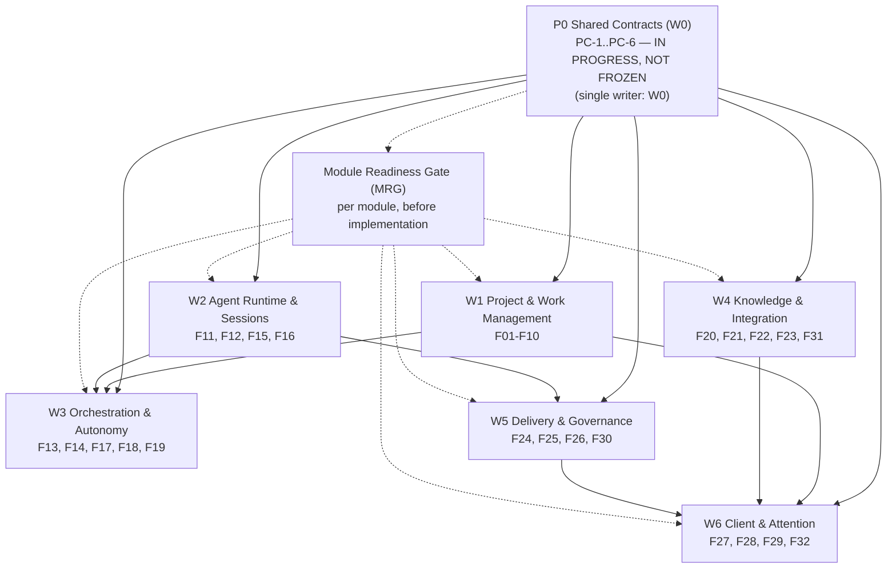

# 24 — Module Responsibility Matrix and Dependency DAG

**Status:** DRAFT (PROPOSED). Produced by YU-392 (G3-W0 Engineering Decomposition & Shared Contracts). **P0 shared contracts are NOT frozen** — they are being converged by W0. All module statuses below are `RESEARCH READY` or `PROTOTYPE READY`; **none is `IMPLEMENTATION READY`** until the relevant P0 contracts are accepted. This document is a proposal for review; it does not authorize implementation or claim that any contract is settled.

**Owner:** W0 (Architecture & Integration) — sole writer of this file and of the shared-contract sections it references.

**Personal-only phase (confirmed 2026-11-12):** current contracts, 1.0–10.0 scope, and MRGs are single-person. No Organization, members, invitations, team roles/RBAC, shared-team workspaces, team collaboration flows, or multi-tenancy in this phase. F01 (Workspace and Organization) is implemented as a single Personal Owner workspace in this phase; team features are deferred beyond 10.0/current gates. Personal authorization, per-Project/per-Agent/tool scopes, human approval, audit, and recovery remain.

**Naming (personal phase):** `PersonalSpace` is canonical; `Workspace`/`workspace_id` is accepted as a compatibility alias during the personal phase. No Organization semantics.

---

## 1. Purpose and status

This document delivers the YU-392 "modules and dependencies" work package:

- a responsibility matrix for all **32 functional groups (F01–F32)** retained as full product scope (see `docs/01-functional-catalog.md`);
- the proposed mapping of each group to one of the **seven execution workstreams (W0–W6)** defined in Notion §14.3;
- a proposed module boundary and module name for each group;
- key dependencies (other F groups and/or P0 shared contracts);
- the current **Module Readiness Gate (MRG)** status of each group;
- a dependency DAG across workstreams and the P0 contract gate.

It is deliberately honest about what is still open: **the six P0 shared contracts listed in §5 are IN PROGRESS and not frozen.** Consequently no module is `IMPLEMENTATION READY`, and any module that has not passed its own MRG may only do research, specification, or isolated mock/fixture prototyping — it must not write production data or assume a canonical contract.

### 1.1 Scope of this document

- **In scope:** module boundaries, owners, dependencies, readiness status, DAG, open gaps, next actions for W0.
- **Out of scope (owned elsewhere):** domain schema/IDs (W0 shared contract), state machines (W0), Command/Event envelope (W0), Policy/Approval (W0), Local Session contract (W0), Work Package templates (`docs/templates/work-package.md`), CI (W0/YU-399), version roadmap (YU-398/G4).

### 1.2 Reading order

1. `docs/00-product-charter.md` — product invariants.
2. `docs/01-functional-catalog.md` — the 32 groups (source of names).
3. `docs/02-domain-model.md` — domain objects and authority rules.
4. `docs/12-development-roadmap.md` — stages and parallelization (§3).
5. `docs/14-open-decisions.md` — confirmed vs. proposed decisions.
6. `docs/19-pre-development-readiness.md` — G0–G5 gates and W0/S1–S5 structure.
7. Notion: Agent Project OS 00–03 (product decisions), §14.3 (workstreams), §14.4 (MRG).

### 1.3 Naming (personal phase)

Naming: `PersonalSpace` is canonical; `Workspace`/`workspace_id` is accepted as an alias during the personal phase. No Organization semantics.

---

## 2. References

| Source | Role |
|---|---|
| Notion 00 — Product definition & core principles | Product invariants, GO decision |
| Notion 01 — System overall architecture | Service boundaries, domain objects |
| Notion 02 — Development sequence / workstreams | Stage ordering |
| Notion 03 — Pre-development readiness (this is the authority for G0–G5, W0–W6, MRG) | Workstreams §14.3, MRG §14.4, P0/P1 list §14.2 |
| `docs/01-functional-catalog.md` | Canonical names of F01–F32 (v0.3) |
| `docs/02-domain-model.md` | Object boundaries and canonical-writer rule |
| `docs/12-development-roadmap.md` | Stages 0–7, streams W0–W6, parallelization rules |
| `docs/14-open-decisions.md` | Confirmed/proposed/open decisions |
| `docs/17-agent-development-contract.md` | Work discipline, evidence, review |
| `docs/18-local-agent-session-subsystem.md` | Local Session subsystem contract |
| `docs/19-pre-development-readiness.md` | Gate status and W0/S1–S5 structure |
| `docs/20-design-baseline.md`, `docs/21-architecture-review.md`, `docs/22-mature-module-reuse-assessment.md` | G0–G2 evidence |

**Authority rule (per Notion §13.1):** product semantics → Notion 00–03; task identity/status → Linear; code/branches/CI → GitHub; package/API/license facts → official upstream. Conflicts must be registered before continuing.

---

## 3. Workstream ownership (W0–W6)

Per Notion §14.3, workstreams are **responsibility boundaries, not deployment units** — not every F group becomes a service. Each workstream owns a clearly bounded directory/module (roadmap §3–§4). A module's MRG must pass before it can start implementation; a blocked module blocks only its dependents.

| Workstream | Scope (F groups) | Owner role | Primary dependencies | Status |
|---|---|---|---|---|
| **W0 — Architecture & Integration** | P0 shared contracts, ADRs, dependency DAG, CI baseline, shared-file ownership, cross-module review (no F group is owned here; W0 owns the contracts every other workstream consumes) | W0 / Integration Owner (architect + integration lead) | None — starts first; sole writer of shared contracts | IN PROGRESS (YU-392) |
| **W1 — Project & Work Management** | F01, F02, F03, F04, F05, F06, F07, F08, F09, F10 | Project/Work Management lead | Identity, Canonical Writer, Project/Task object & state contracts (P0) | Blocked on P0 (research/prototype allowed) |
| **W2 — Agent Runtime & Sessions** | F11, F12, F15, F16 | Runtime/Session lead | Provider/Session, Run, Event, Policy, Local Runtime contracts (P0 + S2) | Blocked on P0 (research/prototype allowed) |
| **W3 — Orchestration & Autonomy** | F13, F14, F17, F18, F19 | Orchestration lead | Task, Assignment, Run, Policy, Outbox, Workflow contracts (P0 + S1) | Blocked on P0 (research/prototype allowed) |
| **W4 — Knowledge & Integration** | F20, F21, F22, F23, F31 | Knowledge/Integration lead | Resource, Provenance, Context, Skill, Connector, permission contracts (P0 + S3/S5) | Blocked on P0 (research/prototype allowed) |
| **W5 — Delivery & Governance** | F24, F25, F26, F30 | Delivery/Governance lead | Artifact/Evidence, Policy/Approval, Event/Audit contracts (P0) | Blocked on P0 (research/prototype allowed) |
| **W6 — Client & Attention** | F27, F28, F29, F32 | Client/Attention lead | Read model/API, Identity, Sync, Notification, Command Authorization (P0 + S4) | Blocked on P0 (research/prototype allowed) |

**Parallelization rule (roadmap §3–§4):** a workstream may run only after its P0 dependencies are stable or isolated behind a stable, testable Port. No two workstreams may edit the same shared schema/interface/config concurrently; shared files have a single owner (W0 during G3).

---

## 4. Module responsibility matrix (F01–F32)

Columns: **F#** | **Name** (from `docs/01-functional-catalog.md`) | **WS** (workstream) | **Module (proposed)** | **Depends on** (other F# or P0 contracts) | **MRG status** | **Notes**.

Module names are **proposed** (PROPOSED) and will be frozen by W0 only after directory/file-ownership review (YU-399 RFG). `PC-n` refers to the P0 contracts in §5.

| F# | Name (from functional catalog) | WS | Module (proposed) | Depends on | MRG status | Notes |
|---|---|---|---|---|---|---|
| F01 | Workspace and Organization | W1 | `workspace-org` | PC-1, PC-2, PC-5 | RESEARCH READY | **Personal-only phase:** single Personal Owner workspace (no org/members/invitations/team roles/RBAC/multi-tenancy). Access/ownership boundary for one owner + Agent/Runtime/Connector actors; workspace policies; shared Agent/Plugin registry. Team features deferred beyond current gates. |
| F02 | Project Portfolio and Initiative Management | W1 | `project-portfolio` | F01, F03, F04, F05, PC-2 | RESEARCH READY | Cross-project dependencies, capacity/resource views, calendar, portfolio health |
| F03 | Project Lifecycle | W1 | `project-lifecycle` | F01, F04, PC-2, PC-3 | RESEARCH READY | Create/edit/pause/resume/archive/restore/close; templates; bootstrap bundles with reviewed inherited permissions |
| F04 | Project Structure | W1 | `project-structure` | PC-2 | RESEARCH READY | Project/Subproject/Goal/Milestone/phase/area; docs/resources/repos/environments; multiple workstreams per Project; Current State link. **Port provider:** F03 (Project Lifecycle) consumes F04's ProjectStructurePort; F04 does not depend on F03. |
| F05 | Task and Work Package Management | W1 | `task-work-package` | F03, F04, F09, PC-2, PC-3, PC-5 | RESEARCH READY | Task/Subtask, scope/non-scope, acceptance criteria, templates, comments/attachments, activity history |
| F06 | Task Relationships and Dependency Graph | W1 | `task-dependency-graph` | F05, PC-2, PC-3 | RESEARCH READY | Parent/child, blocking/blocked-by, related, duplicate, supersedes, cross-project; DAG validation, cycle detection, ready-work, critical path |
| F07 | Task Lifecycle and Current State | W1 | `task-lifecycle-state` | F05, F06, PC-3, PC-4 | RESEARCH READY | Lifecycle semantics; waiting vs blocked vs awaiting review; state-transition history/actor; Project Current State snapshot; stale-active/review detection |
| F08 | Intake, Triage, and Deduplication | W1 | `intake-triage` | F05, F06, PC-4 | RESEARCH READY | Inbox, external-event intake, classify/enrich/prioritize/accept/decline/snooze/merge, candidate pool before durable Task, duplicate detection, intake policies per Source. **F17 (Workflow) depends on F08 for trigger intake, not vice versa.** |
| F09 | Human and Agent Participants | W1 | `participants` | F01, PC-2, PC-5 | RESEARCH READY | **Personal-only:** one human Personal Owner plus Agent/Runtime/Connector execution actors as distinct participant types; owner (accountable) vs executor separation. No team membership/invitations. Agent can join multiple Projects without fixed membership. **F11 (Agent Registry) depends on F09, not vice versa.** |
| F10 | Collaboration and Communication | W1 | `collaboration-comms` | F03, F05, F09, PC-4 | RESEARCH READY | **Personal-only:** Owner↔Agent and Agent↔Agent communication (comments, mentions, replies, attachments, threaded conversations, decisions linked to Tasks, messages with provenance). No human-team collaboration flows in this phase. |
| F11 | Agent Registry and Capability Management | W2 | `agent-registry` | F09, PC-2, PC-5, PC-6 | PROTOTYPE READY | Register local/remote/cloud/custom Agents; provider/model/version/runtime/capability/cost/health; capability negotiation matrix (native/emulated/unsupported/unknown); discover locally installed Agents; user-defined profiles. **Depends on F09 (participant identity). F23 (Plugin/Connector) depends on F11, not vice versa. RuntimeNodePort provides node health.** |
| F12 | Agent Session Workbench (incl. Local Agent Sessions) | W2 | `agent-session-workbench` | F11, F15, F16, F21, PC-2, PC-4, PC-5, PC-6 | PROTOTYPE READY | Core Desktop capability: discover/create/attach/resume Sessions; continuous bidirectional interaction; stream messages/turns/tool calls/approvals; tabs/panes/fork/archive; cross-Provider Context Handoff; reconnect/replay/reconcile; multi-client observation/control; inspect Context Pack at launch. Contract: `docs/18-local-agent-session-subsystem.md` |
| F13 | Agent Delegation and Assignment | W3 | `assignment-delegation` | F05, F09, F11, PC-2, PC-3, PC-5 | RESEARCH READY | User- or Coordinator-selected assignment; accountable human vs executing Agent; reassign/handoff/retry/replace/terminate; explicit scope/permissions/acceptance criteria; parallel independent assignments |
| F14 | Multi-Agent Coordination | W3 | `multi-agent-coordination` | F06, F13, F15, F25, PC-3, PC-4 | RESEARCH READY | Coordinator/Worker roles; decomposition, fan-out/serial/merge; specialists, cross-review; context handoff; conflict detection, workspace isolation, merge/reconciliation; human intervention/override/re-planning |
| F15 | Run, Event, and Execution Lifecycle | W2 | `run-event-lifecycle` | F13, F16, PC-2, PC-3, PC-4 | PROTOTYPE READY | Durable Assignment/Run records; attempts, state, idempotency, start/end, executor identity, trace; ACK, checkpoint, input request, handoff, failure, interruption, cancel, reconcile; append-only events + replayable projections; artifact/verification/side-effect records. **F24 (Deliverables) depends on F15, not vice versa.** |
| F16 | Execution Environments and Runtime Nodes | W2 | `runtime-node` | F11, F26, PC-1, PC-6 | PROTOTYPE READY | Local Daemon, remote host, cloud worker, sandboxed node; Provider process supervision, attach/reconnect, session discovery, sleep/wake/crash recovery; workspace/checkout/worktree/container/terminal/PTY/browser/preview; per-Run isolation; secure pairing; host online/offline truth. **Depends on F11 (registry) and F26 (permission); provides RuntimeNodePort to F11.** |
| F17 | Workflow and Event Automation | W3 | `workflow-automation` | F08, F15, F26, PC-4, PC-5 | RESEARCH READY | Schedule/time triggers; GitHub/Notion/Feishu/calendar/webhook/app event triggers; conditional routing, correlation, subscriptions, dedup; templates, versioning, history, retries, pause/resume; action execution through permission/approval controls |
| F18 | Intelligent Planning and Assistance | W3 | `intelligent-planning` | F04, F05, F21, PC-5 | RESEARCH READY | Understand intent → Project; create/update goals/tasks/dependencies/acceptance; recommend split/Agent/priority/risks/next actions; summarize Project health/changes; propose plans for human confirmation |
| F19 | Autonomous Execution (sub-capability) | W3 | `autonomous-execution` | F13, F14, F17, F22, PC-3, PC-4, PC-5 | RESEARCH READY | Continue authorized work after a completed step/trigger; select eligible next work and route; bounded retries/recovery; stop and request attention at authority/safety/product-decision boundary; report progress/deliverables/blockers/decisions. Personal Execution Skill is a supporting method input, not a state engine or permission grant |
| F20 | Project Knowledge and Resources | W4 | `knowledge-resources` | F04, F26, PC-2 | RESEARCH READY | Project docs/research/links/files/repos/references/source registry; search/retrieval across authorized resources; document version/provenance; link decisions/tasks/deliverables/discussions to source; external knowledge connectors |
| F21 | Project Memory and Context Assembly | W4 | `memory-context` | F07, F20, F24, PC-4 | RESEARCH READY | Workspace/project/task/session context layers; confirmed decisions/methods/failures/lessons; current+historical reconstruction; Context Packs with freshness/source authority/confidence/supersession/access filtering; inspectable Context Pack before launch; memory extraction gate |
| F22 | Skills, Templates, and Reusable Methods | W4 | `skills-templates` | F11, F17, F20, PC-5 | RESEARCH READY | Install/author/version/test/enable/disable/share Skills; Agent profiles, task/Project/workflow templates; scope-aware applicability & provider compatibility; extract candidate Skills from repeated workflows with validation/approval; provenance/version of user-specific execution Skills; bootstrap bundles. Skills do not own canonical state or bypass permissions |
| F23 | Plugin and Connector Ecosystem | W4 | `plugin-connector` | F11, F20, F26, PC-5 | RESEARCH READY | Agent Provider / Runtime Provider / Service Connector / Trigger/Source / Knowledge Provider plugins; SDK, manifest, capability schema, permission grants, versioning, diagnostics, discovery; integration health, sync cursor, rate limit, error visibility |
| F24 | Deliverables and Artifacts | W5 | `artifacts` | F15, F20, PC-2 | RESEARCH READY | Code commits/branches/PRs/patches, docs, files, reports, demos, screenshots, logs, external links; immutable references (SHA/version/hash); artifact lineage to Task/Assignment/Run/Session/Agent; preview/download/compare/refresh; no large transient logs in canonical event log |
| F25 | Review and Acceptance | W5 | `review-acceptance` | F05, F24, F26, PC-3, PC-5 | RESEARCH READY | Acceptance criteria & evidence checklist; automated checks + independent Agent review; human review & final acceptance; accept/request changes/reject/defer/require more evidence; revision creates new Run preserving Task identity/history; verify actual external (GitHub/CI) state rather than trusting a report |
| F26 | Permission, Risk, and Approval Governance | W5 | `permission-approval` | F01, F09, PC-2, PC-5 | RESEARCH READY | Workspace/Project/Task/Agent/Plugin permission scopes; actor-action-resource authorization; risk tiers (read/local change/private write/public write/merge/destructive); scoped approval bound to exact action+target artifact/commit; credential vault, least privilege, revocation, audit; emergency pause & human override |
| F27 | Project Visualization | W6 | `visualization` | F02, F04, F07, F15, PC-2 | RESEARCH READY | Portfolio/Project dashboards; list/board/timeline/calendar/milestone/task-tree/dependency-graph; workload/capacity views (humans, Agent pools, Runtime Nodes); human/Agent assignment & execution views; run/session timeline, artifact/diff review, risk/blocker map; user-configurable views/filters |
| F28 | Multi-platform Clients | W6 | `clients` | F12, F16, F27, PC-6 | RESEARCH READY | Desktop (full Project OS + local runtime management), Mobile (overview/review/approvals/notifications/Agent interaction/remote control), Web (cross-device workspace for the single owner/remote management); shared domain/API/permission model; device pairing, offline cache, realtime sync, push. **Personal-only:** cross-device serves one owner; no team workspace collaboration. |
| F29 | Attention Center and Notifications | W6 | `attention-notifications` | F10, F15, F25, F26, PC-4 | RESEARCH READY | Actionable approvals/blockers/questions/review requests/significant changes; prioritize by urgency/risk/responsibility; group low-value; Session-specific unread/Agent questions/permission prompts/completion/failure/disconnected-host alerts; unified actionable inbox; snooze/delegate/resolve/trace; per-Project/Agent/Session policies & quiet hours |
| F30 | Observability, Cost, and Operations | W5 | `observability-ops` | F15, F16, F28, PC-4 | RESEARCH READY | Agent/Provider/Runtime/Daemon health & version diagnostics; Session/Run traces, tool-call logs, event-stream lag/gaps, reconnect counts, failures, retries, latency; usage/cost attribution by Project/Task/Run/Session; budget & concurrency limits; incidents/diagnostics/audit views; system & plugin health |
| F31 | Data Portability and Lifecycle | W4 | `data-portability` | F01, F20, F23, PC-1, PC-2 | RESEARCH READY | Export/import workspace/Projects/Tasks/knowledge/Sessions metadata/artifact refs; guided migration from Linear/Jira/Notion/GitHub with preview/field/relation mapping/duplicate detection/provenance/rollback; backup/restore; external ID mapping & conflict resolution; archive/retention; API & data ownership; preserve history across provider/tool switches |
| F32 | Universal Search and Command Palette | W6 | `search-command-palette` | F03, F05, F12, F20, F29, PC-2, PC-5 | RESEARCH READY | Permission-aware global search across Projects/Goals/Tasks/Sessions/messages/Decisions/Knowledge/Resources/Artifacts/Agents/connected external refs; exact+semantic+structured filters/recency/scope/Provider/state; jump to owning Project/Task/Session; keyboard-first command palette; recent items/saved searches/contextual suggestions; distinguish canonical records from indexed external projections |

**Notes on the matrix**

- Names in the "Name" column are taken verbatim (abbreviated only where the catalog heading is long) from `docs/01-functional-catalog.md` §§A–D. The catalog's `Sources` and `Dependencies` lines are the basis for the "Depends on" column; P0 contracts (PC-n) are added where the group touches a shared contract that is still being converged.
- Every F group is retained as full product scope (product constraint: do not silently delete scope). Implementation order is staged; scope is not.
- `PROTOTYPE READY` is assigned only where a dedicated contract document or capability matrix already exists (W2 runtime/session groups: F11, F12, F15, F16). All other groups are `RESEARCH READY`. None is `IMPLEMENTATION READY` because every group ultimately depends on at least one P0 contract that is not yet frozen (§5).

---

## 5. P0 shared contracts status (W0, not frozen)

Per Notion §14.2 (P0) and §13.4 (W0 convergence list). These six contracts are the gate for `IMPLEMENTATION READY`: a module may not enter implementation unless the P0 contracts it depends on are accepted, **or** it is isolated behind a stable, testable Port. Status is `IN PROGRESS` for all six; none is frozen.

| ID | Contract | Status | Owner | Depends on (spikes/other) | Notes |
|---|---|---|---|---|---|
| PC-1 | Canonical Workspace Writer & authority topology (Local-first / Self-hosted Hub / Hybrid; single canonical writer; replicas, caches, offline writes, conflict & recovery boundaries) | IN PROGRESS (W0) — not frozen | W0 | S4 (PowerSync) evidence; deployment topology open (P-021) | External systems own their live facts; local copies are never silently authoritative |
| PC-2 | Core object identity & cardinality (Project, Task, Assignment, Run, Session, ProviderSessionRef, RuntimeProcess, SessionConnection, Review, Approval, etc. — identities, ownership, cardinality, examples) | IN PROGRESS (W0) — not frozen | W0 | Domain model `docs/02-domain-model.md` (PROPOSED) | No two parallel streams may interpret the same object differently (Stage 0 exit gate) |
| PC-3 | State machines (Project, Task, Assignment, Run, Session, Review, Approval, Trigger, Workflow, external side-effect receipts — states, initiators, guards, events, terminal states, retry, cancel, recovery) | IN PROGRESS (W0) — not frozen | W0 | S1 (DBOS) recovery/idempotency evidence | Must include negative/recovery paths, not only happy path |
| PC-4 | Command/Event contract (Command ID, Idempotency Key, Expected Version, Actor/Scope, Correlation/Causation, event ordering, Outbox/Inbox, Receipt, Replay, Reconciliation; **no exactly-once promise**) | IN PROGRESS (W0) — not frozen | W0 | S1 (DBOS) Outbox/replay; S3 (Activepieces) adapter evidence | Unknown external side-effect results must be reconciled before retry |
| PC-5 | Policy, Mandate & Approval (authorization, risk tiers, Mandate, Approval bound to exact Action/Target/Artifact, single-use consume, revoke, in-flight permission changes, fail-closed; enforced in code/runtime, not only in prompts) | IN PROGRESS (W0) — not frozen | W0 | P-020 (authorization model), S5 (Skills governance) | Personal Execution Skill is a method input, never a permission grant |
| PC-6 | Local Session (Session vs. ProviderSessionRef / RuntimeProcess / SessionConnection / Transcript; Controller Lease, command serialization, event cursor, gaps, reconnect, history reconciliation; native resume vs. process reattach vs. restart-with-context vs. opaque terminal) | IN PROGRESS (W0) — not frozen | W0 | S2 (Paseo/ACP) real-Provider evidence; `docs/18-local-agent-session-subsystem.md` | Provider limitations, credentials, and host offline truth must be tested; never mislabel integration kinds |

**Supporting (P1) contracts** are owned by modules in parallel and must not be piled into W0 (Notion §14.2 P1): Context Pack source precedence/conflict/staleness; Experience-to-Skill candidate/validation/approval/rollback; non-code workspace isolation & resource conflicts; Attention Inbox ordering/dedup/responsibility/snooze/thresholds; self-hosted deploy/upgrade/backup/restore/secret recovery; Plugin sandbox/signature/compatibility/update/permission visibility; Workspace/Team/cross-Workspace role matrix.

---

## 6. Dependency DAG

### 6.1 Workstream order with the P0 contract gate

Reading notes:

- The **P0 gate** sits in front of every workstream: no workstream may assume a frozen canonical contract. Where a dependency is not yet accepted, the workstream must isolate behind a stable, testable Port or limit itself to research/prototype.
- **W1 → W3/W6**, **W2 → W3/W5**, **W4 → W6**, **W5 → W6** are the cross-workstream dependency edges that must hold before those downstream workstreams can integrate (not necessarily before they can research or prototype in isolation).
- A blocked module blocks **only its dependents**; unrelated modules and workstreams continue (Notion §14.4). Global G3/G4/G5 remain the final gates for full-system integration and release.

### 6.2 Within-workstream dependency chains (proposed)

- **W1:** F01 → F03/F04 → F05 → (F06, F09) → F07 → F08/F10; F02 sits on F01/F03/F04/F05.
- **W2:** F16 + F11 → F15 → F12 (F12 also needs F21 from W4 and PC-4/PC-5/PC-6).
- **W3:** F13 (F05/F09/F11) → F14 (F06/F13/F15/F25) and F19; F17 (F08/F15/F26) feeds F19; F18 (F04/F05/F21) is largely independent.
- **W4:** F20 (F04/F26) → F21 (F07/F20/F24) and F22 (F11/F17/F20); F23 (F11/F20/F26); F31 (F01/F20/F23).
- **W5:** F24 (F15/F20) → F25 (F05/F24/F26); F26 (F01/F09) is foundational for W2/W3/W4; F30 (F15/F16/F28) depends on W6 client work.
- **W6:** F27 (F02/F04/F07/F15) → F28 (F12/F16/F27) and F32 (F03/F05/F12/F20/F29); F29 (F10/F15/F25/F26) feeds F32.

These chains are **proposed** for review; they are not a claim that the underlying contracts (state machines, cardinality, command/event) are settled.

---

## 7. Module Readiness Gate (MRG) reminder (Notion §14.4)

A module may enter implementation only when **all** of the following hold:

1. User outcome, F-group scope, Non-scope, and module Owner are explicit.
2. A versioned Module Contract is accepted: data ownership, API/Command/Event, state invariants, error semantics, permissions, side effects.
3. The P0 dependencies it touches are accepted, **or** isolated behind a stable, testable Port.
4. Runtime, package manager, version matrix, build, and test environment are known.
5. Directory, shared-file Owner, Worktree, and Branch are explicit.
6. Contract Fixtures, acceptance tests, and relevant negative/recovery tests exist.
7. License, Secret, Sandbox, permission, and external side-effect boundaries are explicit.
8. Independent Reviewer, stop conditions, and rollback plan are explicit.

**Gate statuses (Notion §14.4):**

- `RESEARCH READY` — evidence research may proceed.
- `PROTOTYPE READY` — isolated mock/fixture prototyping allowed; **no writes to production data, no assumption of a canonical contract.**
- `IMPLEMENTATION READY` — all MRG criteria pass; implementation may start.
- `MODULE ACCEPTED` — independent acceptance passed.
- `INTEGRATION ACCEPTED` — contract + integration acceptance with direct dependents passed.

**Current status (as of this draft):** every F group is `RESEARCH READY` or `PROTOTYPE READY` (see §4). **No module is `IMPLEMENTATION READY`**, because each depends on at least one P0 contract that is still `IN PROGRESS` and not frozen (§5), and no Module Contract has yet been accepted. A module that has not passed MRG may only research, specify, or build isolated prototypes; it must not add production dependencies, run database migrations, implement product APIs, deploy, or publish.

---

## 7.5 DAG cycle fixes (2026-11-12, per Coordinator independent review)

Four cycles identified in the Coordinator independent review were resolved by establishing correct ownership direction and narrow Ports:

| Cycle | Fix | Port introduced |
|---|---|---|
| F03 ↔ F04 | F04 (Project Structure) is foundational; F03 (Project Lifecycle) depends on F04. Removed F03 from F04's deps. | `ProjectStructurePort` |
| F11 ↔ F16 | F11 (Agent Registry) depends on F09 (participant identity), not F16. F16 (Runtime) depends on F11. Removed F16 from F11's deps. | `RuntimeNodePort` |
| F15 ↔ F24 | F24 (Deliverables) depends on F15 (Run produces artifacts). F15 does not depend on F24. Removed F24 from F15's deps. | `ArtifactPort` |
| F09 → F11 → F16 → F26 → F09 | F09 depends on F01/PC-2/PC-5 (removed F11). F11 depends on F09. F16 depends on F11+F26. F26 depends on F09. No cycle. | `RuntimeNodePort`, `PermissionPort` |
| F08 ↔ F17 | F08 (Intake) does not depend on F17 (Workflow). F17 depends on F08 (intake produces triggers). Removed F17 from F08's deps. | `TriggerPort` |
| F11 ↔ F23 | F11 does not depend on F23 (Plugin/Connector). F23 depends on F11. Removed F23 from F11's deps. | `PluginHostPort` |

**Automated validation:** `python scripts/validate_dag.py` (exit 0 = acyclic, exit 1 = cycles found). CI should run this as a check.

## 8. Known gaps and open questions

1. **P0 contracts unfrozen** (§5) — the single biggest blocker. Until PC-1..PC-6 are accepted, no module can be `IMPLEMENTATION READY`.
2. **Module names and directories are proposed** — final ownership/directory freeze belongs to W0 + YU-399 (RFG). Sub-workstreams must not create directories or shared files on their own.
3. **No Module Contract has been authored yet** for any F group (`docs/templates/module-contract.md` exists but is unpopulated). YU-392's "Work Package" item covers this; it is not done by this file alone.
4. **F-group → competitor benchmark coverage is incomplete** (Notion §14.1): 32 groups have no per-module benchmark table. YU-398 (R1) owns this in parallel.
5. **G4 version roadmap (1.0–10.0) is DRAFT IN PARALLEL** (YU-398); module-to-release slicing is not frozen. Do not imply a release commitment from this matrix.
6. **P1 contracts are deliberately left to modules** (§5) and are not yet assigned owners in detail; some (e.g. Context Pack precedence, Skill governance, non-code isolation) may need W0 adjudication if they turn out to cross module boundaries.
7. **CI baseline is unverified** (Notion §13.2): PR #1 has no status checks, workflow runs, or reviews. RFG-5 (YU-399) must close this before "green CI" can be claimed.
8. **Tech stack, database, and deployment topology are not frozen** (P-014, P-021, P-022). Module readiness cannot assume a specific runtime; Ports must be used where a decision is open.
9. **F30 (Observability) depends on F28 (Clients)** for part of its scope, creating a cross-workstream (W5↔W6) dependency that must be sequenced during integration.
10. **F12 depends on W4 (F21 memory/context)** and on PC-4/PC-5/PC-6, so the Session Workbench cannot be fully implemented until those converge — isolated prototyping against fixtures is allowed now.

---

## 9. Next actions for W0 (YU-392)

1. **Converge P0 contracts PC-1..PC-6** as the single writer, using isolation drafts prepared by sub-agents; accept or explicitly gate each before any module can advance to `IMPLEMENTATION READY`.
2. **Author the first Module Contracts** (from `docs/templates/module-contract.md`) for the W2 runtime/session groups (F11, F12, F15, F16) since they are already `PROTOTYPE READY` and have the deepest existing contract material (`docs/18-local-agent-session-subsystem.md`).
3. **Publish shared-file ownership + directory map** (YU-399 RFG) and record it alongside this matrix; no sub-workstream may create shared files until then.
4. **Define Contract Fixtures** for PC-2/PC-3/PC-4 (object cardinality, state machines, command/event envelope) so modules can prototype against stable, testable Ports.
5. **Coordinate with YU-398 (R1)** to attach the per-F-group competitor benchmark coverage and G4 release-slice proposal; update this matrix's "Depends on / Notes" columns if a dependency changes.
6. **Coordinate with YU-393..YU-397 (S1–S5)** to fold spike evidence (DBOS, Paseo/ACP, Activepieces, PowerSync, Agent Skills) into the relevant PC-n rows and module notes; a passing spike only means "eligible for ADR evaluation," not a frozen selection.
7. **Independent review:** have a non-implementing reviewer verify this matrix against `docs/01-functional-catalog.md` (all 32 names present), Notion §14.3 (workstream scopes), and §14.4 (MRG criteria) before it is treated as the W0 baseline.
8. **Do not** claim CI green, do not merge PR #1, do not start product code, and do not add production dependencies until the respective gates (RFG, MRG, license/ownership) pass.

---

**End of document.** This is a DRAFT/PROPOSED artifact of YU-392. P0 shared contracts are not frozen; module statuses reflect that fact. Report completion to the delegating agent with the changed file path and this status.
